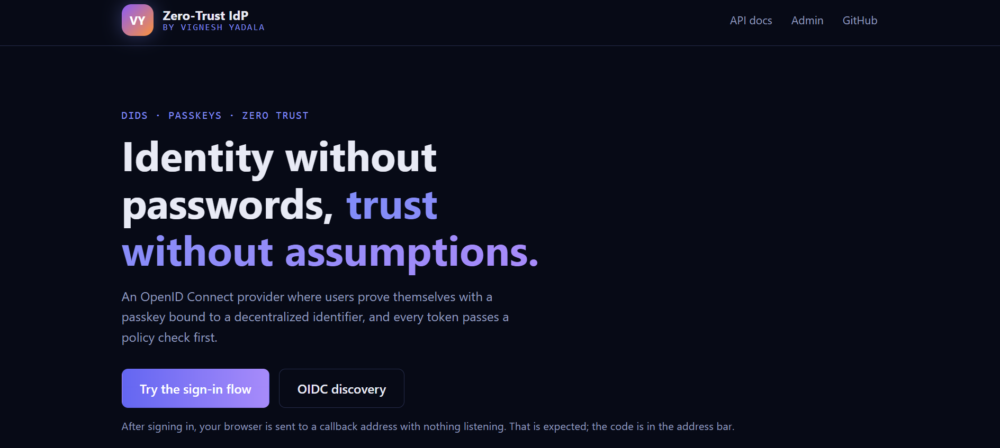
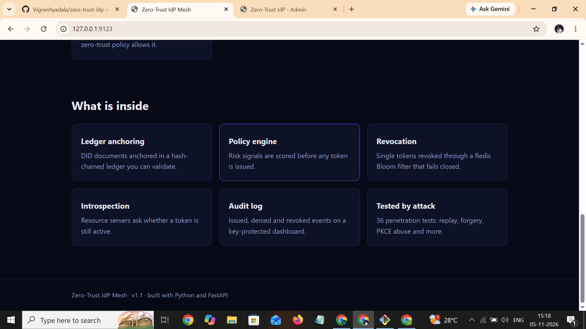
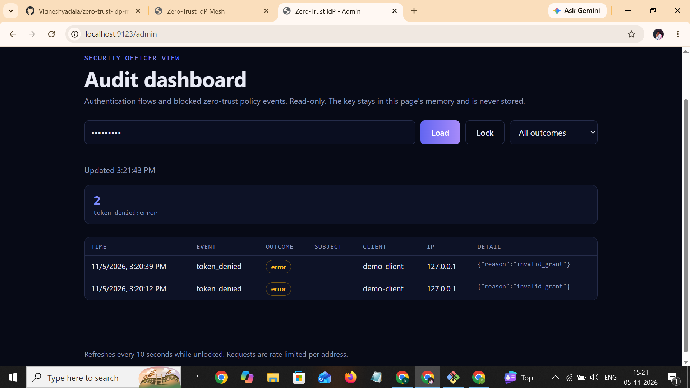

<div align="center">


<br>


**[About](#-about) · [Features](#-features) · [Architecture](#-architecture) · [Quick start](#-quick-start) · [Demo](#-demo-sign-in-and-replay-test) · [Security](#-security) · [Developer](#-developer)**

</div>

---

## 📌 About

A decentralized, zero-trust identity provider built with Python and FastAPI. It replaces username and password tables with **Decentralized Identifiers (DIDs)**, **WebAuthn passkeys (FIDO2)** and cryptographic identity anchoring, and speaks standard **OpenID Connect / OAuth 2.0** so any application can sign users in with it.

There is no password to phish or leak. The user's DID private key is created in the browser and never leaves it, and every sign-in is checked by a zero-trust policy engine before a token is issued.

> Enterprise Project 3 of the Zaalima Development Pvt. Ltd. internship program.

## ✨ Features

| | Feature | What it does |
|---|---------|--------------|
| 🔑 | **OIDC / OAuth 2.0 server** | Discovery, JWKS, authorization code flow with mandatory PKCE (S256), EdDSA-signed JWTs, single-use 60-second codes, exact redirect matching |
| 🪪 | **DID identities** | `did:key` (ed25519) generated in the browser, resolver at `/did/{did}`, simulated hash-chained ledger anchoring |
| 👆 | **Passkey login** | WebAuthn registration and sign-in bound to a DID, no passwords anywhere |
| 🛡️ | **Zero-trust policy engine** | Risk score from IP blocklist, device and user-verification signals and time of day; high risk blocks issuance and burns the code |
| 🚫 | **Token revocation** | `POST /revoke` (RFC 7009 style), in-memory or Redis Bloom filter store, fails closed if Redis is down |
| 🔍 | **Introspection** | `POST /introspect` (RFC 7662 style) so resource servers see revocation immediately |
| 📜 | **Audit log and admin dashboard** | Token issued, denied and revoked events, read-only dashboard behind an `X-Admin-Key` |
| ⏱️ | **Rate limiting** | Per-client limits with HTTP 429 and `Retry-After`, blocked requests are audited |
| 🧪 | **Penetration tests** | 36 attack tests: replay, `alg: none`, algorithm confusion, tampering, PKCE downgrade, redirect abuse and more |
| 🐳 | **Deployment** | Non-root Docker image, compose stack with Redis and Traefik, local HTTPS, production TLS configuration |

## 🛠️ Tech stack


## 🧩 Architecture

**Sign-in flow**

```
  Browser                    IdP (FastAPI)                      Relying party
     |                             |                                  |
     |   1. /authorize (PKCE)      |                                  |
     |---------------------------->|                                  |
     |   2. passkey sign-in (DID)  |                                  |
     |<--------------------------->|                                  |
     |                             |-- risk score (policy engine)     |
     |                             |-- audit event                    |
     |   3. redirect with code     |                                  |
     |<----------------------------|                                  |
     |                             |   4. /token (code + verifier)    |
     |                             |<---------------------------------|
     |                             |   5. EdDSA access + ID token     |
     |                             |--------------------------------->|
     |                             |   6. /introspect (is it active?) |
     |                             |<---------------------------------|
```

**Deployment**

```
  Internet ──> Traefik (TLS, HSTS) ──> App (FastAPI, non-root) ──> Redis (Bloom filter, password)
               only published port     private Docker network      internal network only
```

| Service | Tech | Role |
|---------|------|------|
| Traefik | Traefik | TLS termination, HTTP to HTTPS redirect, the only published port |
| App | FastAPI + Uvicorn | OIDC endpoints, passkeys, policy engine, admin dashboard |
| Redis | Redis | Revocation Bloom filters (optional, in-memory store by default) |

## 🚀 Quick start

**Run locally**

```
python -m venv .venv
source .venv/Scripts/activate      # Git Bash on Windows
pip install -r requirements.txt
uvicorn app.main:app --reload
```

Interactive API docs: http://127.0.0.1:8000/docs. Health check: `/health`. Service version: `/version`.

**Run the tests and the release check**

```
python -m pytest -v
python scripts/release_check.py
```

The release check changes nothing. It confirms the docs, test counts and tracked files agree.

**Run with Docker (app, Redis, Traefik, local HTTPS)**

```
python scripts/gen_dev_cert.py
echo "IDP_ADMIN_KEY=choose-a-long-random-value" > .env
echo "REDIS_PASSWORD=choose-another-long-random-value" >> .env
docker compose -f docker-compose.yml -f docker-compose.local.yml up -d --build
```

The service is then at https://localhost:8443 (self-signed certificate, so the browser shows a warning) and http://localhost:8000 redirects to it. Stop with:

```
docker compose -f docker-compose.yml -f docker-compose.local.yml down
```

<details>
<summary><b>⚙️ Configuration reference</b></summary>

<br>

| Variable | Purpose | Default |
|----------|---------|---------|
| `IDP_ISSUER` | Token issuer URL | `http://localhost:8000` |
| `IDP_RP_ID` | WebAuthn relying party ID | `localhost` |
| `IDP_RP_ORIGIN` | WebAuthn origin | `http://localhost:8000` |
| `IDP_REQUIRE_UV` | Require WebAuthn user verification | `1` |
| `IDP_DEV_LOGIN` | Development-only login (never in production) | `0` |
| `IDP_REDIS_URL` | Use the Redis Bloom revocation store | unset (in-memory) |
| `REDIS_PASSWORD` | Docker compose only: Redis password, required by the compose stack | none; set it in `.env` |
| `IDP_BLOCKED_NETWORKS` | Comma-separated CIDRs the policy engine blocks | none |
| `IDP_ALLOWED_HOURS` | Allowed hours, `start-end`, in the policy time zone | `6-22` |
| `IDP_TIMEZONE` | Policy time zone, an IANA name such as `Asia/Kolkata`; unknown names fall back to UTC | server local time (`UTC` in Docker) |
| `IDP_DENY_THRESHOLD` | Risk score that blocks issuance | `70` |
| `IDP_ADMIN_KEY` | Admin dashboard key (dashboard off if unset) | unset |
| `IDP_AUDIT_FILE` | Also write audit events to this JSON-lines file | unset |
| `IDP_RATE_LIMIT` | Requests per window per client, `requests/seconds`, or `off` | `30/60` |
| `IDP_INTROSPECTION_KEY` | Key for `POST /introspect` (endpoint off if unset) | unset |

</details>

## 🎬 Demo: sign-in and replay test

A manual end-to-end check that takes about three minutes. Any free port works; 9123 is used here (see [Troubleshooting](#-troubleshooting) if port 8000 is blocked on Windows).

**1️⃣ Start the server**

```
IDP_ADMIN_KEY=localtest IDP_ISSUER=http://localhost:9123 IDP_RP_ORIGIN=http://localhost:9123 uvicorn app.main:app --port 9123
```

**2️⃣ Open this link in Chrome**

```
http://localhost:9123/authorize?response_type=code&client_id=demo-client&redirect_uri=http%3A%2F%2Flocalhost%3A8080%2Fcallback&scope=openid&state=abc&nonce=n1&code_challenge=E9Melhoa2OwvFrEMTJguCHaoeK1t8URWbuGJSstw-cM&code_challenge_method=S256
```

**3️⃣ Sign in with a passkey.** Create an identity, register a passkey and sign in. Chrome ends on `localhost:8080/callback?code=...`, which will not load because nothing listens on port 8080. That is expected. Copy the value after `code=` and before `&state`.

**4️⃣ Exchange the code within 60 seconds.** The verifier matches the code challenge in the link (it is the sample from RFC 7636):

```
curl -s -X POST http://localhost:9123/token -d grant_type=authorization_code -d code=PASTE_CODE_HERE -d redirect_uri=http://localhost:8080/callback -d client_id=demo-client -d code_verifier=dBjftJeZ4CVP-mB92K27uhbUJU1p1r_wW1gFWFOEjXk
```

Expected: JSON with an `access_token`, an `id_token`, `token_type` `Bearer` and `expires_in` 3600.

**5️⃣ Replay test.** Run the same command again. Expected: an `invalid_grant` error, because an authorization code works only once.

**6️⃣ Check the audit log.** Open http://localhost:9123/admin, enter the key `localtest` and click Load. Expected: one `token_issued` success row and one `token_denied` error row for the replay.

> The key `localtest` is for local testing only. Use your own value in any real deployment.

## 🔒 Security

- ✅ Mandatory PKCE (S256), single-use 60-second authorization codes, exact `redirect_uri` matching
- ✅ EdDSA signing with the algorithm pinned on verification (no `alg: none`, no HS256 confusion)
- ✅ Every token carries a `jti`; revoked tokens are rejected, and the Redis store fails closed
- ✅ Tokens and authorization codes are never written to the audit log
- ✅ Non-root Docker image with a health check and no secrets baked in; only Traefik is published
- ✅ Private signing key (`keys/`), passkey credentials (`data/`), `.env` and certificates are git-ignored
- ✅ All commits are signed (SSH signing)

<details>
<summary><b>⚠️ Known limits (read before deploying)</b></summary>

<br>

- `IDP_DEV_LOGIN=1` enables a development-only login that trusts the `login_hint` DID without proof. It is off by default and must never be enabled in a deployed environment.
- Authorization codes are stored in memory (single process).
- The policy engine's known-device signal is a placeholder assumed true. The user-verification signal is real but only changes decisions when `IDP_REQUIRE_UV=0`, since the default refuses logins without user verification.
- Behind a proxy, the app trusts forwarded client addresses from any source (`--forwarded-allow-ips=*`). This is acceptable only because the app is reachable solely through Traefik on a private network.
- Redis requires a password in the compose stack and is reachable only from the internal Docker network. There is no TLS between the app and Redis.
- Production TLS (Let's Encrypt) is configured and validated but has not been run against a live domain.

</details>

## 📸 Screenshots

**Landing page**



**What is inside**



**Admin audit dashboard**, unlocked with the admin key and showing denied token requests:



## 📁 Project layout

```
app/core/           settings and JWT signing
app/did/            ed25519 keys, did:key resolver, DID documents
app/ledger/         simulated ledger anchoring of DID documents
app/oidc/           OIDC / OAuth 2.0 endpoints, PKCE, client registry
app/passkeys/       WebAuthn registration and login, credential store
app/policy/         zero-trust risk scoring and enforcement
app/revocation/     token revocation (in-memory and Redis Bloom filter)
app/introspection/  token introspection for resource servers (RFC 7662 style)
app/ratelimit/      per-client rate limiting
app/home/           landing page (/) with a live status strip
app/audit/          audit log of authentication events
app/admin/          admin API and dashboard page
app/web/            HTML, CSS and JavaScript pages
deploy/traefik/     reverse proxy routing and TLS configuration
scripts/            helper scripts (development certificate generator, release check)
tests/              pytest suite, including the penetration tests
docs/               test evidence and the final report
assets/             README banner
```

Project status by week:

| Week | Scope | State |
|------|-------|-------|
| 1 | OIDC / OAuth 2.0 server, ed25519 DIDs, repo rules | ✅ Complete |
| 2 | WebAuthn passkeys, simulated ledger anchoring | ✅ Complete |
| 3 | Zero-trust policy engine, token revocation, admin dashboard | ✅ Complete |
| 4 | Penetration tests, Docker + Traefik deployment, final report | ✅ Complete |

The test suite has 186 automated tests passing (1 skipped: the live-Redis test, which runs only when `IDP_REDIS_URL` is set). Attack-test results are in `docs/pentest-results.txt` and the final report is in `docs/report/`.

## 🩺 Troubleshooting

**`[WinError 10013]` when starting the server on Windows.** Windows can reserve whole blocks of ports (Hyper-V, WSL and Docker often do), and port 8000 may fall inside one. List the reserved ranges in Git Bash:

```
netsh interface ipv4 show excludedportrange protocol=tcp
```

Pick any port outside every listed range, for example 9123, and start the server there:

```
uvicorn app.main:app --port 9123
```

If you sign in with passkeys or check tokens on a non-default port, set `IDP_ISSUER` and `IDP_RP_ORIGIN` to the same address, for example `http://localhost:9123`, so the issuer and WebAuthn origin match the address in the browser.

## 🌿 Branching

Feature branches (`feat/...`, `docs/...`, `fix/...`) merged into `main` with `--no-ff`.

## 👤 Developer

| | |
|---|---|
| **Name** | Vignesh Yadala |
| **Role** | Designed and built end to end (Enterprise Project 3, Zaalima Development Pvt. Ltd. internship program) |
| **GitHub** | [@Vigneshyadala](https://github.com/Vigneshyadala) |
| **Portfolio** | [vigneshyadala.github.io/portfolio](https://vigneshyadala.github.io/portfolio/) |

<div align="center">

Built with Python, FastAPI, WebAuthn and Docker.

<sub>© Vignesh Yadala 2026</sub>

</div>
