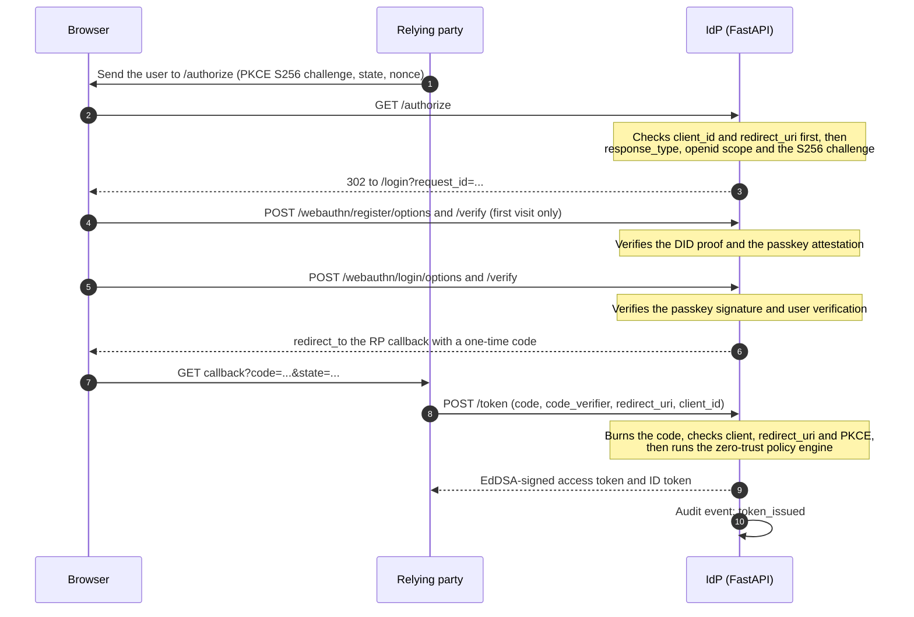

# How it works

A plain-language walkthrough of what happens when an application signs a user in with Zero-Trust IdP Mesh, and where each step lives in the code.

## The cast

| Who | What they do |
|-----|--------------|
| **User and browser** | Holds a DID (a `did:key` ed25519 identity created in the browser) and a passkey. The DID private key never leaves the browser. |
| **Relying party (RP)** | The application that wants to know who the user is. It starts the sign-in and later receives the tokens. |
| **IdP** | This service (FastAPI). It checks the request, runs the passkey ceremony, applies the zero-trust policy, issues signed tokens and records everything in the audit log. |

## Sign-in sequence

If any check fails, no token is issued and an audit event records why:

| Failure | Result | Audit event |
|---------|--------|-------------|
| Unknown client or unregistered `redirect_uri` | HTTP 400, no redirect (so `/authorize` can never be used as an open redirector) | none |
| Missing PKCE, wrong scope or wrong response type | Error sent back to the registered `redirect_uri` | none |
| Code unknown, expired, already used, or wrong verifier | `invalid_grant` (HTTP 400) | `token_denied`, outcome `error` |
| Risk score at or above the threshold | `access_denied` (HTTP 403), and the code is already burned | `token_denied`, outcome `blocked` |

## After sign-in

- **Verify a token yourself.** Fetch the public key from `/jwks.json` (discovery document: `/.well-known/openid-configuration`). Tokens are signed with EdDSA and the algorithm is pinned, so `alg: none` and HS256 tricks are rejected.
- **Ask the IdP.** A resource server can call `POST /introspect` (with the `X-Introspection-Key` header) to learn whether an access token is still active, so revoked tokens stop working everywhere.
- **Revoke.** `POST /revoke` records the token's `jti` in the revocation store (in memory by default, or a Redis Bloom filter). It always answers 200, so it cannot be used to test whether a token is valid.

## The zero-trust policy engine

Every token request gets a risk score from several signals: the IP blocklist (`IDP_BLOCKED_NETWORKS`), device and user-verification signals, and the time of day (`IDP_ALLOWED_HOURS`, in the zone set by `IDP_TIMEZONE`). A score at or above `IDP_DENY_THRESHOLD` blocks issuance. Nothing is trusted just because the passkey login succeeded.

## Audit and export

Every issued, denied and revoked token produces an audit event. Tokens and authorization codes are never written to the log. A security officer can read the events in three ways, all behind the `X-Admin-Key` header and the rate limiter:

- the dashboard at `/admin` (refreshes every 10 seconds while unlocked),
- the JSON API: `GET /admin/api/summary` and `GET /admin/api/events`,
- a spreadsheet export: `GET /admin/api/events.csv` (the **Download CSV** button), with an optional `outcome` filter and a `limit` of up to 500 rows. Cells that start with `=`, `+`, `-` or `@` are prefixed with an apostrophe so a spreadsheet cannot run them as formulas.

## Where each step lives

| Step | Code |
|------|------|
| Discovery and keys | `app/oidc/router.py`, `app/core/signing.py` |
| `/authorize`, PKCE, `/token` | `app/oidc/` |
| DID parsing and resolver | `app/did/` |
| Passkey registration and login | `app/passkeys/` |
| Risk scoring and enforcement | `app/policy/` |
| Revocation and introspection | `app/revocation/`, `app/introspection/` |
| Rate limiting | `app/ratelimit/` |
| Audit log, dashboard and CSV export | `app/audit/`, `app/admin/`, `app/web/` |
| Simulated ledger anchoring of DIDs | `app/ledger/` |

For the full design, the cryptographic workflows and the security audit, see the final report in [`docs/report/`](report/full-report.md).
