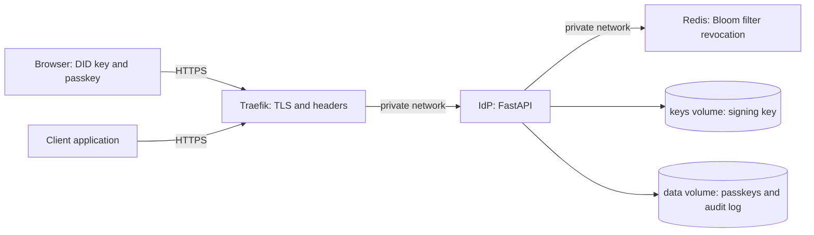
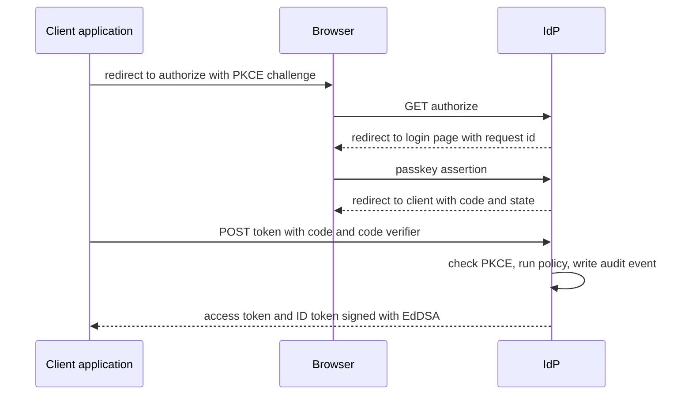

# 1. Architecture

## 1.1 Purpose

Traditional authentication servers keep a table of usernames and passwords,
which makes them a single point of failure and a high-value target. This
system removes the password table. A user is identified by a Decentralized
Identifier (DID) and proves control of it with a WebAuthn (FIDO2) passkey. The
server issues standard OpenID Connect tokens only after a zero-trust policy
check, and every issued token can be revoked individually.

## 1.2 Components

| Component | Location | Responsibility |
|-----------|----------|----------------|
| OIDC / OAuth 2.0 server | `app/oidc/` | Discovery, `/authorize`, `/token`, PKCE, client registry |
| Token signing | `app/core/signing.py` | EdDSA (Ed25519) JWTs, JWKS, verification with a pinned algorithm |
| DID layer | `app/did/` | `did:key` (Ed25519) resolution and DID documents |
| Ledger | `app/ledger/` | Simulated ledger that anchors DID documents |
| Passkeys | `app/passkeys/` | WebAuthn registration and login, credential store |
| Policy engine | `app/policy/` | Risk scoring and the allow or deny decision at `/token` |
| Revocation | `app/revocation/` | `/revoke`, revocation stores (in-memory, Redis Bloom filter) |
| Introspection | `app/introspection/` | RFC 7662-style `POST /introspect`, key-protected, so resource servers can honour revocation |
| Rate limiting | `app/ratelimit/` | Per-client sliding-window limits on `/token`, `/revoke`, `/introspect` and the admin API |
| Login page | `app/web/` | Browser page for DID creation, passkey registration and sign-in |
| Audit log | `app/audit/` | Records issued, denied and revoked events |
| Admin dashboard | `app/admin/` | Key-protected read-only view of the audit log |
| Reverse proxy | `deploy/traefik/` | TLS termination, HTTP to HTTPS redirect, security headers |
| Redis | compose service | Shared revocation state for the mesh |

## 1.3 Deployment view

Only Traefik publishes ports to the host. The application and Redis sit on a
private Docker network. The application runs as an unprivileged user, and the
signing key and passkey data live in volumes, never in the image.

## 1.4 Sign-in flow

1. The client sends the user to `/authorize` with a PKCE challenge (S256 is
   mandatory) and an exact, pre-registered `redirect_uri`.
2. The server stores the request and sends the browser to the login page.
3. The user signs in with a passkey. The DID was generated in the browser and
   its private key never leaves it.
4. On a successful assertion the server issues a single-use authorization
   code that lives for 60 seconds and is bound to the user's DID.
5. The client exchanges the code at `/token` together with the PKCE code
   verifier.
6. The server consumes the code, evaluates the zero-trust policy, records an
   audit event, and returns an access token and an ID token.

## 1.5 Trust boundaries

| Zone | Trusted with | Not trusted with |
|------|--------------|------------------|
| Browser | The user's DID private key and passkey | Anything the server decides |
| Traefik | TLS termination and header hardening | Application logic |
| IdP application | The signing key, token issuance, policy decisions | The client's identity claims, which are always verified |
| Redis | Revocation state | Secrets (it holds only token identifiers) |
| Admin interface | Read-only audit data | Any write operation; it is disabled unless `IDP_ADMIN_KEY` is set |

## 1.6 Key design decisions

- **No password table.** Identity is a DID plus a passkey, so there is nothing
  reusable to steal from the server.
- **PKCE is mandatory** and only S256 is accepted. The `plain` method and
  requests without a challenge are refused.
- **Signing algorithm is pinned to EdDSA** on verification, which rejects
  `alg: none` and algorithm-confusion tokens.
- **Authorization codes are single use and short lived**, and a failed
  exchange also consumes the code.
- **Every token carries a `jti`**, so a single token can be revoked without
  affecting others. Verification checks revocation on every use.
- **Revocation fails closed.** If Redis is unreachable the Redis store treats
  tokens as revoked, so an outage blocks sign-ins rather than letting revoked
  tokens through.
- **Policy before issuance.** A risk score is computed from the request. A
  score at or above the threshold returns `access_denied` (HTTP 403) and no
  token is issued.
- **The audit log never stores tokens or codes**, only event type, outcome,
  subject, client, address and a small detail object.
- **Least privilege at runtime.** Non-root container, secrets outside the
  image, `.env` and certificate keys excluded from Git.
- **Resource servers ask the IdP instead of guessing.** `POST /introspect` returns
  `{"active": false}` for anything unsigned, forged, expired, revoked or issued for
  another audience, with identical answers so the reason is not revealed.
- **Sensitive endpoints are rate limited.** Requests to `/token`, `/revoke`,
  `/introspect` and the admin API are counted per client address; excess requests
  get HTTP 429 with `Retry-After` and are written to the audit log. A request
  refused with 429 never reaches the handler, so it cannot consume an authorization
  code.

## 1.7 Scope and simulation notes

- The ledger is a **simulation** of blockchain anchoring, as the project plan
  allows. It is an append-only, hash-chained list of blocks stored in
  `data/ledger.json`. Each block holds an index, timestamp, entry and the
  previous block's hash, and its own SHA-256 hash covers all four. There is
  no consensus or distribution: one process owns the file, so the ledger
  detects accidental or partial tampering but not a complete rewrite by
  someone who controls the file (see section 2.6).
- Authorization codes are held in process memory, so the service runs as a
  single instance. Revocation state is the only shared state, and it uses
  Redis when configured.