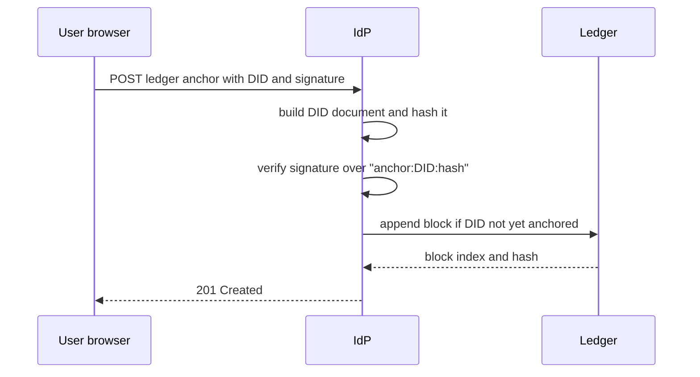

# 2. Cryptographic Workflows

## 2.1 Decentralized identifiers (DIDs)

A user's identity is a `did:key` identifier built from an Ed25519 public key
(the multibase `z6Mk...` form). The key pair is generated in the user's
browser and the private key never leaves it. The server resolves a DID to a
DID document (`GET /did/{did}`) without storing any account record. Because a
`did:key` document is derived from the key itself, resolution needs no lookup
and cannot be altered by the server.

## 2.2 Passkey registration and sign-in (WebAuthn)

**Registration** (`POST /webauthn/register/options`, then `/register/verify`):

1. The browser sends its DID. The server validates it and extracts the
   Ed25519 public key.
2. The server returns WebAuthn registration options with a fresh challenge.
   The relying party ID is `IDP_RP_ID`.
3. The browser creates the passkey (Windows Hello, a phone or a security key)
   and returns the attestation.
4. The server verifies the response against the challenge, the expected relying
   party ID and the expected origin (`IDP_RP_ORIGIN`). User verification (PIN or
   biometric) is required when `IDP_REQUIRE_UV=1` (the default) and only
   preferred when it is `0`.
5. The registration is bound to the DID by a proof. The browser signs the
   message `webauthn-register:{did}:{challenge}` with the DID's Ed25519 key
   and sends the signature as `did_proof`; the server checks it against the
   public key in the DID. The message contains the single-use registration
   challenge, so a signature cannot be replayed for another registration.
6. The credential, its public key and its sign count are stored against the DID
   (`data/`, git-ignored). The endpoint answers 201.

**Sign-in** (`POST /webauthn/login/options`, then `/login/verify`):

1. The browser asks for options for a DID and receives a challenge.
2. The authenticator signs the challenge. The server verifies the assertion
   against the stored credential public key, the relying party ID, the origin
   and the stored sign count, again requiring user verification when enabled.
3. On success the stored sign count is updated and the server issues the
   single-use authorization code described in section 2.3.

**Properties and limits**

- The relying party ID and origin checks bind each passkey to this service, so
  a credential cannot be used from a look-alike site.
- The sign counter is a clone-detection signal: an assertion whose counter does
  not increase is rejected by the WebAuthn library. Many synced passkeys (for
  example, Google Password Manager) always report a counter of zero, so for
  those the check gives no protection.
- A WebAuthn deployment is tied to its origin. Changing the host or scheme
  (for example, from `http://localhost:8000` to `https://localhost:8443`)
  invalidates existing passkeys, and users register again.

## 2.3 Authorization code and PKCE

- The client sends a PKCE challenge (`code_challenge`, method `S256`).
  Requests without a challenge, or with method `plain`, are refused.
- After a successful sign-in the server issues a random authorization code,
  valid for 60 seconds and bound to the client, the exact `redirect_uri`, the
  user's DID and the challenge.
- At `/token` the code is **consumed first**, then checked: client, redirect
  URI and `SHA-256(code_verifier)` against the stored challenge. A failed
  attempt therefore also destroys the code, so a stolen code cannot be
  retried with guessed verifiers.

## 2.4 Token signing and verification

| Item | Value |
|------|-------|
| Algorithm | EdDSA (Ed25519) |
| Header | `alg: EdDSA`, `kid` = first 12 bytes of SHA-256(public key), base64url |
| Claims | `iss`, `sub` (the user's DID), `aud`, `iat`, `exp`, `jti`, plus `scope` and `client_id` |
| Access token | audience is the issuer; lifetime 3600 s |
| ID token | audience is the client; carries the `nonce` when one was sent |
| Key storage | `keys/` volume, git-ignored, never inside the container image |
| Public key | published at `/jwks.json` |

Verification pins the algorithm list to `["EdDSA"]` and checks signature,
issuer, audience and expiry. Pinning rejects `alg: none` tokens and
algorithm-confusion attempts (for example an HS256 token "signed" with the
public key). It then checks the token's `jti` against the revocation store.

## 2.5 Revocation

Every token carries a unique `jti`. `POST /revoke` accepts a token, verifies
its signature first (so only a holder of a genuine token can revoke it), and
records its `jti` until the token's own expiry. The endpoint always answers
HTTP 200, so it cannot be used to test whether a token is valid.

Two stores implement one interface:

- **In-memory**: default, used in tests and single-process runs.
- **Redis Bloom filter**: one filter per hour, keyed by the hour in which the
  token expires, each with a TTL just past that hour so Redis removes old
  filters itself. A Bloom filter never misses a revoked `jti` (no false
  negatives); its false-positive rate is configured at 0.1%, meaning a valid
  token may very rarely be rejected and the user signs in again. If Redis is
  unreachable the store fails closed and reports tokens as revoked.

## 2.6 Ledger anchoring

1. The server builds the DID document, serializes it as canonical JSON
   (sorted keys, no whitespace) and takes its SHA-256 hash.
2. The signed message is `anchor:{did}:{document_hash}`. The fixed prefix is
   domain separation, so a signature made for anchoring cannot be replayed in
   another context. The signature must verify under the DID's own key, which
   proves control of the DID.
3. The ledger appends a block: `index`, `timestamp`, `entry`
   (`did_anchor`, DID, document hash) and `previous_hash`. The block's `hash`
   is SHA-256 over the canonical JSON of those four fields. The first block
   uses a previous hash of 64 zeros.
4. A DID can be anchored once; a second attempt returns HTTP 409.
5. `GET /ledger/did/{did}` compares the anchored document hash with a freshly
   computed one and returns `matches`. `GET /ledger/chain` recomputes every
   block hash and link and reports whether the chain is valid.
6. Writes use a temporary file and an atomic replace, so a crash cannot leave
   a half-written ledger.

**Limits (state these in the audit):** the ledger is a simulation. A single
process owns the JSON file, so `validate()` detects an edited block but cannot
detect someone who rewrites the whole chain consistently. There is no
consensus, replication, or external timestamping, and a `did:key` document has
no additional data to bind beyond the key itself. A production design would
anchor to an external chain or an IPFS-based store, or at minimum publish the
latest block hash to a place the operator cannot silently change.