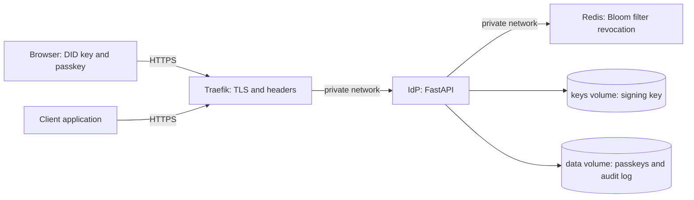
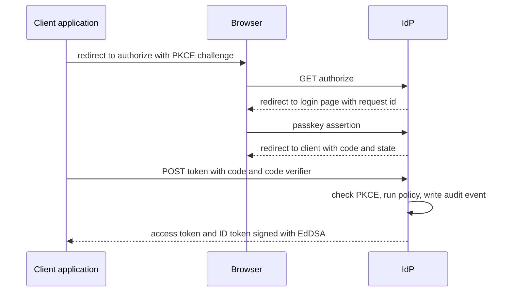
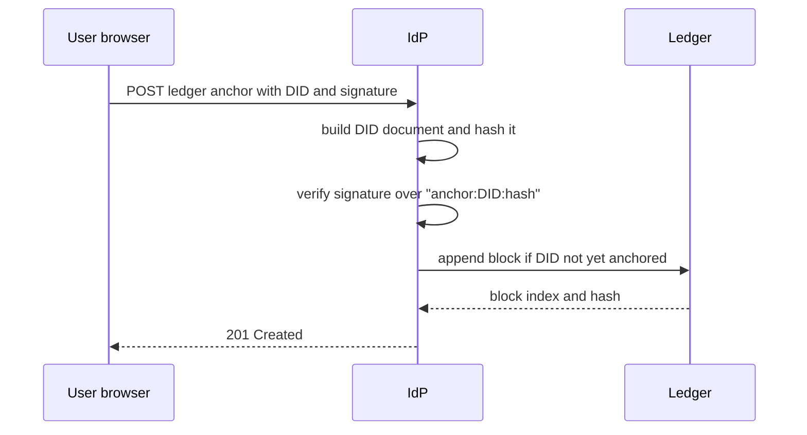

# 1. Architecture

## 1.1 Purpose

Traditional authentication servers keep a table of usernames and passwords,
which makes them a single point of failure and a high-value target. This
system removes the password table. A user is identified by a Decentralized
Identifier (DID) and proves control of it with a WebAuthn (FIDO2) passkey. The
server issues standard OpenID Connect tokens only after a zero-trust policy
check, and every issued token can be revoked individually.

## 1.2 Components

| Component | Location | Responsibility |
|-----------|----------|----------------|
| OIDC / OAuth 2.0 server | `app/oidc/` | Discovery, `/authorize`, `/token`, PKCE, client registry |
| Token signing | `app/core/signing.py` | EdDSA (Ed25519) JWTs, JWKS, verification with a pinned algorithm |
| DID layer | `app/did/` | `did:key` (Ed25519) resolution and DID documents |
| Ledger | `app/ledger/` | Simulated ledger that anchors DID documents |
| Passkeys | `app/passkeys/` | WebAuthn registration and login, credential store |
| Policy engine | `app/policy/` | Risk scoring and the allow or deny decision at `/token` |
| Revocation | `app/revocation/` | `/revoke`, revocation stores (in-memory, Redis Bloom filter) |
| Audit log | `app/audit/` | Records issued, denied and revoked events |
| Admin dashboard | `app/admin/` | Key-protected read-only view of the audit log |
| Reverse proxy | `deploy/traefik/` | TLS termination, HTTP to HTTPS redirect, security headers |
| Redis | compose service | Shared revocation state for the mesh |

## 1.3 Deployment view



Only Traefik publishes ports to the host. The application and Redis sit on a
private Docker network. The application runs as an unprivileged user, and the
signing key and passkey data live in volumes, never in the image.

## 1.4 Sign-in flow



1. The client sends the user to `/authorize` with a PKCE challenge (S256 is
   mandatory) and an exact, pre-registered `redirect_uri`.
2. The server stores the request and sends the browser to the login page.
3. The user signs in with a passkey. The DID was generated in the browser and
   its private key never leaves it.
4. On a successful assertion the server issues a single-use authorization
   code that lives for 60 seconds and is bound to the user's DID.
5. The client exchanges the code at `/token` together with the PKCE code
   verifier.
6. The server consumes the code, evaluates the zero-trust policy, records an
   audit event, and returns an access token and an ID token.

## 1.5 Trust boundaries

| Zone | Trusted with | Not trusted with |
|------|--------------|------------------|
| Browser | The user's DID private key and passkey | Anything the server decides |
| Traefik | TLS termination and header hardening | Application logic |
| IdP application | The signing key, token issuance, policy decisions | The client's identity claims, which are always verified |
| Redis | Revocation state | Secrets (it holds only token identifiers) |
| Admin interface | Read-only audit data | Any write operation; it is disabled unless `IDP_ADMIN_KEY` is set |

## 1.6 Key design decisions

- **No password table.** Identity is a DID plus a passkey, so there is nothing
  reusable to steal from the server.
- **PKCE is mandatory** and only S256 is accepted. The `plain` method and
  requests without a challenge are refused.
- **Signing algorithm is pinned to EdDSA** on verification, which rejects
  `alg: none` and algorithm-confusion tokens.
- **Authorization codes are single use and short lived**, and a failed
  exchange also consumes the code.
- **Every token carries a `jti`**, so a single token can be revoked without
  affecting others. Verification checks revocation on every use.
- **Revocation fails closed.** If Redis is unreachable the Redis store treats
  tokens as revoked, so an outage blocks sign-ins rather than letting revoked
  tokens through.
- **Policy before issuance.** A risk score is computed from the request. A
  score at or above the threshold returns `access_denied` (HTTP 403) and no
  token is issued.
- **The audit log never stores tokens or codes**, only event type, outcome,
  subject, client, address and a small detail object.
- **Least privilege at runtime.** Non-root container, secrets outside the
  image, `.env` and certificate keys excluded from Git.

## 1.7 Scope and simulation notes

- The ledger is a **simulation** of blockchain anchoring, as the project plan
  allows. It is an append-only, hash-chained list of blocks stored in
  `data/ledger.json`. Each block holds an index, timestamp, entry and the
  previous block's hash, and its own SHA-256 hash covers all four. There is
  no consensus or distribution: one process owns the file, so the ledger
  detects accidental or partial tampering but not a complete rewrite by
  someone who controls the file (see section 2.6).
- Authorization codes are held in process memory, so the service runs as a
  single instance. Revocation state is the only shared state, and it uses
  Redis when configured.# 2. Cryptographic Workflows

## 2.1 Decentralized identifiers (DIDs)

A user's identity is a `did:key` identifier built from an Ed25519 public key
(the multibase `z6Mk...` form). The key pair is generated in the user's
browser and the private key never leaves it. The server resolves a DID to a
DID document (`GET /did/{did}`) without storing any account record. Because a
`did:key` document is derived from the key itself, resolution needs no lookup
and cannot be altered by the server.

## 2.2 Passkey registration and sign-in (WebAuthn)

**Registration** (`POST /webauthn/register/options`, then `/register/verify`):

1. The browser sends its DID. The server validates it and extracts the
   Ed25519 public key.
2. The server returns WebAuthn registration options with a fresh challenge.
   The relying party ID is `IDP_RP_ID`.
3. The browser creates the passkey (Windows Hello, a phone or a security key)
   and returns the attestation.
4. The server verifies the response against the challenge, the expected relying
   party ID and the expected origin (`IDP_RP_ORIGIN`). User verification (PIN or
   biometric) is required when `IDP_REQUIRE_UV=1` (the default) and only
   preferred when it is `0`.
5. The registration is bound to the DID by a proof. The browser signs the
   message `webauthn-register:{did}:{challenge}` with the DID's Ed25519 key
   and sends the signature as `did_proof`; the server checks it against the
   public key in the DID. The message contains the single-use registration
   challenge, so a signature cannot be replayed for another registration.
6. The credential, its public key and its sign count are stored against the DID
   (`data/`, git-ignored). The endpoint answers 201.

**Sign-in** (`POST /webauthn/login/options`, then `/login/verify`):

1. The browser asks for options for a DID and receives a challenge.
2. The authenticator signs the challenge. The server verifies the assertion
   against the stored credential public key, the relying party ID, the origin
   and the stored sign count, again requiring user verification when enabled.
3. On success the stored sign count is updated and the server issues the
   single-use authorization code described in section 2.3.

**Properties and limits**

- The relying party ID and origin checks bind each passkey to this service, so
  a credential cannot be used from a look-alike site.
- The sign counter is a clone-detection signal: an assertion whose counter does
  not increase is rejected by the WebAuthn library. Many synced passkeys (for
  example, Google Password Manager) always report a counter of zero, so for
  those the check gives no protection.
- A WebAuthn deployment is tied to its origin. Changing the host or scheme
  (for example, from `http://localhost:8000` to `https://localhost:8443`)
  invalidates existing passkeys, and users register again.

## 2.3 Authorization code and PKCE

- The client sends a PKCE challenge (`code_challenge`, method `S256`).
  Requests without a challenge, or with method `plain`, are refused.
- After a successful sign-in the server issues a random authorization code,
  valid for 60 seconds and bound to the client, the exact `redirect_uri`, the
  user's DID and the challenge.
- At `/token` the code is **consumed first**, then checked: client, redirect
  URI and `SHA-256(code_verifier)` against the stored challenge. A failed
  attempt therefore also destroys the code, so a stolen code cannot be
  retried with guessed verifiers.

## 2.4 Token signing and verification

| Item | Value |
|------|-------|
| Algorithm | EdDSA (Ed25519) |
| Header | `alg: EdDSA`, `kid` = first 12 bytes of SHA-256(public key), base64url |
| Claims | `iss`, `sub` (the user's DID), `aud`, `iat`, `exp`, `jti`, plus `scope` and `client_id` |
| Access token | audience is the issuer; lifetime 3600 s |
| ID token | audience is the client; carries the `nonce` when one was sent |
| Key storage | `keys/` volume, git-ignored, never inside the container image |
| Public key | published at `/jwks.json` |

Verification pins the algorithm list to `["EdDSA"]` and checks signature,
issuer, audience and expiry. Pinning rejects `alg: none` tokens and
algorithm-confusion attempts (for example an HS256 token "signed" with the
public key). It then checks the token's `jti` against the revocation store.

## 2.5 Revocation

Every token carries a unique `jti`. `POST /revoke` accepts a token, verifies
its signature first (so only a holder of a genuine token can revoke it), and
records its `jti` until the token's own expiry. The endpoint always answers
HTTP 200, so it cannot be used to test whether a token is valid.

Two stores implement one interface:

- **In-memory**: default, used in tests and single-process runs.
- **Redis Bloom filter**: one filter per hour, keyed by the hour in which the
  token expires, each with a TTL just past that hour so Redis removes old
  filters itself. A Bloom filter never misses a revoked `jti` (no false
  negatives); its false-positive rate is configured at 0.1%, meaning a valid
  token may very rarely be rejected and the user signs in again. If Redis is
  unreachable the store fails closed and reports tokens as revoked.

## 2.6 Ledger anchoring



1. The server builds the DID document, serializes it as canonical JSON
   (sorted keys, no whitespace) and takes its SHA-256 hash.
2. The signed message is `anchor:{did}:{document_hash}`. The fixed prefix is
   domain separation, so a signature made for anchoring cannot be replayed in
   another context. The signature must verify under the DID's own key, which
   proves control of the DID.
3. The ledger appends a block: `index`, `timestamp`, `entry`
   (`did_anchor`, DID, document hash) and `previous_hash`. The block's `hash`
   is SHA-256 over the canonical JSON of those four fields. The first block
   uses a previous hash of 64 zeros.
4. A DID can be anchored once; a second attempt returns HTTP 409.
5. `GET /ledger/did/{did}` compares the anchored document hash with a freshly
   computed one and returns `matches`. `GET /ledger/chain` recomputes every
   block hash and link and reports whether the chain is valid.
6. Writes use a temporary file and an atomic replace, so a crash cannot leave
   a half-written ledger.

**Limits (state these in the audit):** the ledger is a simulation. A single
process owns the JSON file, so `validate()` detects an edited block but cannot
detect someone who rewrites the whole chain consistently. There is no
consensus, replication, or external timestamping, and a `did:key` document has
no additional data to bind beyond the key itself. A production design would
anchor to an external chain or an IPFS-based store, or at minimum publish the
latest block hash to a place the operator cannot silently change.# 3. Security Audit

## 3.1 Scope and method

The audit covers the identity provider service: the OIDC and OAuth endpoints,
token signing and verification, the zero-trust policy engine, revocation, the
audit log, the admin dashboard, and the container and proxy configuration.

Method: an automated penetration suite (`tests/test_pentest.py`) in which each
test plays the attacker; a passing test means the attack failed. The suite runs
in-process against the real application. Output is saved in
`docs/pentest-results.txt` and can be reproduced with:

    python -m pytest tests/test_pentest.py -v

Result at the time of writing: 18 attack tests, all resisted. The full suite
has 110 passing tests and 1 skipped (the live-Redis test, which runs only when
`IDP_REDIS_URL` is set).

## 3.2 Threat results

| # | Class | Attack | Result |
|---|-------|--------|--------|
| 1 | Replay | Reuse an authorization code after a successful exchange | Refused (`invalid_grant`) |
| 2 | Replay | Use an access token after it was revoked | Refused |
| 3 | Replay | Use an expired token | Refused |
| 4 | Forgery | Unsigned token (`alg: none`) | Refused |
| 5 | Forgery | HS256 token signed with the public key (algorithm confusion) | Refused |
| 6 | Forgery | Token signed with an attacker's Ed25519 key | Refused |
| 7 | Forgery | Valid token with its payload edited (`sub`, `exp`) | Refused |
| 8 | Forgery | Token issued for a different audience | Refused |
| 9 | Forgery | Token claiming a different issuer | Refused |
| 10 | Flow abuse | Authorization request without PKCE | No code issued |
| 11 | Flow abuse | PKCE downgrade to the `plain` method | No code issued |
| 12 | Flow abuse | Unregistered `redirect_uri` | No redirect, no code |
| 13 | Interception | Stolen code redeemed with a wrong verifier | Refused, no token |
| 14 | Interception | Failed guess, then the real owner retries | Code is already burned; both refused |
| 15 | Interception | Code redeemed without a verifier | Refused |
| 16 | Interception | Code redeemed against a different `redirect_uri` | Refused |
| 17 | Flow abuse | Token request from an unknown client | Refused (HTTP 401) |
| 18 | Leakage | Token response caching | `Cache-Control: no-store` present |

## 3.3 Man-in-the-middle

The in-process suite cannot test the network. Transport protection was checked
separately against the Docker stack: HTTPS is served by Traefik, plain HTTP
answers with a redirect to HTTPS, and responses carry `X-Frame-Options: DENY`,
`X-Content-Type-Options: nosniff` and `Referrer-Policy: no-referrer`. The
development certificate is self-signed. The production configuration (Let's
Encrypt, automatic renewal, HSTS) is written and validated but has not been run
against a live domain.

At the application layer, PKCE with S256 and exact `redirect_uri` matching
mean that an intercepted authorization code is useless without the client's
code verifier.

## 3.4 Findings and limitations

Severity is the author's assessment for a production deployment.

| ID | Finding | Severity | Status |
|----|---------|----------|--------|
| F1 | Revocation is enforced inside the IdP's token verification only. A resource server that validates tokens with the published key alone will not see revocations. There is no introspection endpoint. | Medium | Open. Add an introspection endpoint |
| F2 | `/revoke` verifies tokens with the issuer as audience, so only access tokens can be revoked; ID tokens are ignored | Low | Open. ID tokens are for the client only |
| F3 | The policy engine's device-known and user-verified signals are placeholders assumed true. Only IP and time of day are active | Medium | Open. Store these facts with the code at login |
| F4 | No rate limiting or lockout on `/token`, `/revoke` or the admin key check | Medium | Open. Add a rate limit at Traefik or in the app |
| F5 | Admin access uses one shared key in a header, compared in constant time. No per-user identity, no expiry | Medium | Open. Bind admin access to a DID and passkey |
| F6 | Audit log is an in-memory buffer of 1000 events; the optional file is not tamper-evident | Medium | Open. Hash-chain the file or ship it off-host |
| F7 | Authorization codes live in process memory, so the service is single-instance | Low | Accepted for this scope. Move to Redis to scale out |
| F8 | The app trusts forwarded client addresses from any source (`--forwarded-allow-ips=*`) | Low | Mitigated: the app is reachable only through Traefik on a private network |
| F9 | Redis has no password or TLS and relies on network isolation | Low | Mitigated by isolation. Add auth for production |
| F10 | The ledger is a simulation: `validate()` detects an edited block but not a complete consistent rewrite of the file | Medium | Accepted. See section 2.6 |
| F11 | Time-of-day policy uses server local time; the container clock is UTC | Low | Open. Make the time zone configurable |
| F12 | Redis Bloom filter has a 0.1% false-positive rate: a valid token may be rejected and the user signs in again | Low | Accepted and documented |
| F13 | WebAuthn ceremony attacks (for example, a replayed assertion) are not part of the penetration suite | Low | Open. Add tests |
| F14 | Production TLS and HSTS are untested against a live domain | Low | Open. Verify when a domain is available |

## 3.5 Controls verified

- Algorithm pinned to EdDSA; `alg: none` and HS256 confusion rejected.
- PKCE (S256) mandatory; `plain` and missing challenges rejected.
- Authorization codes are single use, expire in 60 seconds, and a failed
  exchange also consumes the code.
- Exact `redirect_uri` matching, with no open redirect.
- Revocation fails closed when Redis is unreachable.
- Policy decision runs before any token is issued; a denied request burns the
  code.
- Secrets are kept out of Git and out of the image: signing key, passkey data,
  `.env`, and certificate keys.
- Container runs as a non-root user and only the proxy publishes ports.
- The admin dashboard is disabled unless `IDP_ADMIN_KEY` is set, and it renders
  event data with `textContent`, so log content cannot inject script.

## 3.6 Recommended next steps

1. Add an introspection endpoint so resource servers can honour revocation (F1).
2. Add rate limiting and temporary lockout (F4).
3. Carry the real device and user-verification facts into the policy engine (F3).
4. Replace the shared admin key with DID and passkey authentication (F5).
5. Make the audit log tamper-evident and durable (F6).
6. Add a password to Redis (F9) and run the production TLS configuration
   against a real domain (F14).# 4. Deployment, Operations and Conclusion

## 4.1 Container image

The `Dockerfile` builds from `python:3.12-slim`, installs the pinned
requirements, copies only the `app/` package and runs as an unprivileged user
(uid 10001). The signing key and passkey data are never baked into the image:
`.dockerignore` excludes `keys/`, `data/`, `.env`, tests and documents, and both
directories are mounted as volumes at runtime. A health check calls `/health`
every 15 seconds.

## 4.2 Compose stack

| Service | Image | Published ports | Role |
|---------|-------|-----------------|------|
| `app` | built from `Dockerfile` | none | The IdP, reached only through Traefik |
| `redis` | `redis/redis-stack-server` | none | Revocation state (Bloom filters) |
| `traefik` | `traefik:v3.1` | 8000, 8443 (local) or 80, 443 (production) | TLS termination, redirect, security headers |

All three share a private network. `app` starts only after Redis reports
healthy. Traefik reads its routes from files, so it needs no access to the
Docker socket. Named volumes hold the signing key (`idp-keys`), passkeys, ledger
and audit file (`idp-data`) and Redis data (`redis-data`).

Configuration is by environment variables (listed in the README). Secrets such
as `IDP_ADMIN_KEY` live in `.env`, which is git-ignored.

## 4.3 Local run with HTTPS

```
python scripts/gen_dev_cert.py
echo "IDP_ADMIN_KEY=choose-a-long-random-value" > .env
docker compose -f docker-compose.yml -f docker-compose.local.yml up -d --build
```

The service answers at `https://localhost:8443`; `http://localhost:8000`
redirects to it. The development certificate is self-signed, so browsers warn
about it. The local override sets the issuer and WebAuthn origin to the HTTPS
address, because a passkey is bound to its origin.

Verified results of this setup:

| Check | Result |
|-------|--------|
| `https://localhost:8443/health` | 200 with security headers |
| `http://localhost:8000/health` | 302 redirect to the HTTPS address |
| Discovery document | issuer is `https://localhost:8443` |
| Redis | healthy; app started after it |

## 4.4 Production configuration (written, not run)

`docker-compose.prod.yml` and `deploy/traefik/prod-routes.yml` add:

- a `Host()` rule for the real domain
- Let's Encrypt certificates (TLS-ALPN challenge), stored in the `letsencrypt`
  volume and renewed automatically by Traefik
- redirection of all HTTP to HTTPS at the entry point
- an HSTS header (one year)

Steps to deploy, on a server with a public domain whose DNS points to it and
ports 80 and 443 open:

1. Put `IDP_ADMIN_KEY`, `IDP_DOMAIN` and `ACME_EMAIL` in `.env`.
2. Replace `idp.example.com` in `deploy/traefik/prod-routes.yml` with the domain.
3. Test first against the Let's Encrypt staging server by adding
   `--certificatesresolvers.letsencrypt.acme.caserver=https://acme-staging-v02.api.letsencrypt.org/directory`
   to the Traefik command, then remove it.
4. Start the stack:

```
docker compose -f docker-compose.yml -f docker-compose.prod.yml up -d --build
```

**Status:** this configuration validates (`docker compose config`), and it
refuses to start if `IDP_DOMAIN` or `ACME_EMAIL` is missing, but it has not been
run against a live domain because none was available during the project.

## 4.5 Backup and recovery

Two volumes hold state that cannot be recreated:

- `idp-keys`: the signing key. Losing it invalidates every issued token and
  changes the published key ID.
- `idp-data`: passkey credentials, the ledger and the audit file. Losing it
  means users must register again, and DID anchors are lost.

Back up a volume to a file (check the exact volume name first with
`docker volume ls`; Compose prefixes it with the project name):

```
docker volume ls
MSYS_NO_PATHCONV=1 docker run --rm -v zero-trust-idp-mesh_idp-keys:/data -v "$PWD":/backup alpine tar czf /backup/keys-backup.tgz -C /data .
```

Restore with the reverse (`tar xzf ... -C /data`) into an empty volume. Store
backups off the host and never commit them to Git; the signing key is a secret.
Redis holds only revocation entries that expire on their own, so it does not need
backing up.

## 4.6 Operations notes

- **Key rotation.** The service publishes a single signing key, so replacing it
  invalidates all issued tokens at once. Supporting two keys in the JWKS during
  a rotation is future work.
- **Passkeys and origin.** Changing the host or scheme changes the WebAuthn
  origin, so existing passkeys stop working.
- **Time zone.** The container clock is UTC; the policy engine's allowed hours
  use server local time.
- **Audit.** The in-memory audit buffer is lost on restart unless
  `IDP_AUDIT_FILE` is set (the compose file sets it to `/srv/data/audit.log`).
- **Common local problem.** If `docker` commands fail with "failed to connect to
  the docker API", Docker Desktop is not running.
- **Port clash.** The local stack uses host ports 8000 and 8443; stop any
  development server on 8000 first.

## 4.7 Testing summary

| Suite | Tests |
|-------|-------|
| Week 1 and 2 (OIDC, DID, ledger, passkeys, signing) | 45 |
| Policy engine, runtime and `/token` enforcement | 15 |
| Revocation, Redis store, `/revoke` | 15 (one live-Redis test skipped) |
| Audit log and its wiring | 10 |
| Admin dashboard | 8 |
| Penetration tests | 18 |
| **Total** | **111 collected: 110 passed, 1 skipped** |

The skipped test exercises a live Redis and runs when `IDP_REDIS_URL` is set. The
Redis store is otherwise covered by tests against a fake client.

## 4.8 Conclusion

The project replaces a password table with DIDs and WebAuthn passkeys, issues
standards-based OIDC tokens signed with EdDSA, and puts a zero-trust policy check
in front of every issuance. Tokens can be revoked individually through a Redis
Bloom filter that fails closed, events are recorded in an audit log with a
key-protected dashboard, and the whole system runs as a hardened container stack
behind Traefik with TLS.

Against the project plan, every deliverable is implemented and tested, with these
exceptions stated openly: the ledger is a simulation, two policy signals are
placeholders, and the production TLS configuration has not been run against a
live domain. The security audit (section 3) lists these and the other findings
with recommended fixes. The most valuable next steps are an introspection
endpoint so resource servers honour revocation, real device and user-verification
signals in the policy engine, rate limiting, and DID-based admin authentication.
## 4.9 Live Redis verification

The Redis Bloom filter store was exercised against a real Redis Stack
container (`redis/redis-stack-server`) on 22 October 2026 using
`IDP_REDIS_URL=redis://localhost:6379/0 python -m pytest tests/test_redis_store_integration.py`.
The test passed: a revoked identifier was reported revoked, and an unseen
identifier was not.
